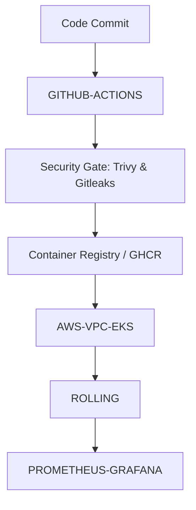

# ADR-001: Architecture Decision Record & Pipeline Topology

- **Status**: Accepted
- **Date**: 2026-10-09
- **Project**: `devops-project`

---

## Context and Problem Statement

Modern DevOps architectures require declarative pipelines, secure containerized delivery, reproducible development environments, and cloud infrastructure as code without vendor lock-in.

## Architecture Topology (Mermaid)

## Decisions

1. **Pipeline Framework**: `python` running on `github-actions`.
2. **Infrastructure**: `aws-vpc-eks` targeting `AWS`.
3. **Deployment Strategy**: `rolling` across `single` environments.
4. **Security & Governance**: `nist-csf` baseline with Gitleaks and Trivy.
5. **Developer Sandbox**: VS Code & Cursor DevContainer enabled.

---
Generated by **DevOps Project Generator CLI (v2.0.0)**.
